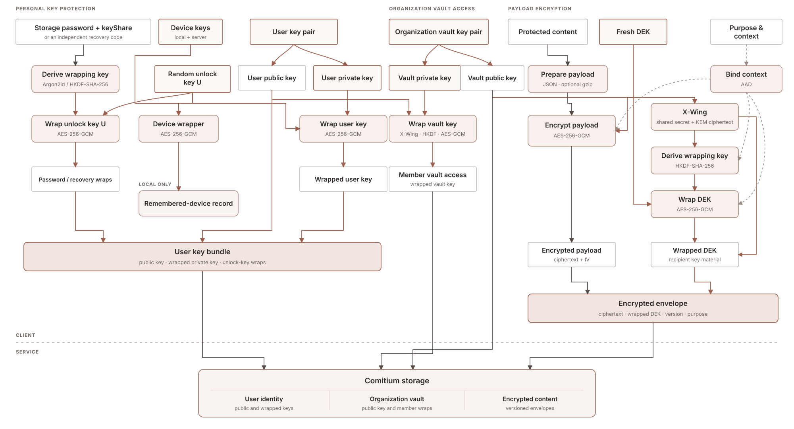

# `@comitium/crypto`

`@comitium/crypto` is Comitium's browser-side encryption package. It protects application answers, resumes and uploads, contact details, notes, feedback, and messages. Public job data and structured fields needed for search and workflows remain plaintext by design.

## Encryption model

The illustration summarizes password/recovery protection, remembered devices, and organization vault access.

  

Each payload is encrypted with a fresh AES-256-GCM data key. That key is wrapped with X-Wing for each allowed recipient, so authorized users can open the same content without sharing private keys.

Authenticated context binds every envelope to its purpose, organization, record, field, and recipient. Moving ciphertext to another context causes decryption to fail, and recipient policies default to deny.

## Key hierarchy

User and organization vault keys are generated in the browser. A member's user private key unlocks their wrapped copy of the organization vault key; the vault key protects organization content.

A user private key is encrypted by a random unlock key U. A storage password combined with `keyShare`, an independent recovery code, or a usable remembered device opens U. Remembered devices require both `localDeviceKey` and a freshly supplied `serverDeviceKey`.

Comitium has no master decryption key. If every valid unlock path is lost, the encrypted data cannot be recovered.

## Runtime and primitives

Application code uses [`CryptoProxy`](src/proxy.ts). Cryptographic operations and long-lived private keys stay inside a dedicated Web Worker; decrypted values return only when needed.

Versioned envelopes use X-Wing (ML-KEM-768 and X25519), HKDF-SHA-256, and AES-256-GCM through Web Crypto and `@noble`. Supported JSON payloads may be compressed before encryption. Unsupported versions fail closed.

Search-key blind indexes share one internal HKDF/HMAC implementation. Tags, custom fields, candidate-profile fields, and reusable application-form fields retain separate wire-frozen namespaces and normalization rules.
